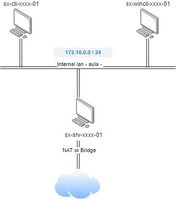

# 📎 UD01P02.- Configuració d'una xarxa local amb DHCP Windows

## Objectiu

L'objectiu de la pràctica és simular el següent escenari de xarxa, amb VirtualBox:

<figure><figcaption></figcaption></figure>

### Requisits:

Hem de configurar 3 màquines virtuals:

* 1 client amb LUbuntu 22.0
* 1 client amb Windows 10
* 1 servidor amb Windows Server 2022

Les dues màquines virtuals client estaran connectades a la xarxa interna 'aula', amb una interfície de xarxa configurada amb IP dinàmica. Rebran de la màquina server almenys els següents paràmetres:

* IP
* Mascara de xarxa
* Porta d'enllaç
* Servidors DNS

La numeració de les màquines client començarà per la x=125, i amb x màxima 150.

La targeta de xarxa de la xarxa interna del servidor estarà configurada de manera estàtica. La IP de la màquina server haurà de correspondre amb la IP de porta d'enllaç per defecte de la xarxa.

Hem de configurar la màquina server perquè actue com a porta d'enllaç amb l'exterior.  Per a aconseguir-ho caldrà:

* Afegir-li una segona interfície de xarxa en mode NAT o bridge (de VirtualBox).
* Instal·lar i configurar els paquets necessaris perquè la màquina funcione com a "gateway" per a la resta de màquines de la xarxa 'aula' (la resta de màquines podran accedir a Internet).&#x20;

### Format de l'entrega

* Opció 1: crear un document PDF.
* Opció 2: Gravar un vídeo.

En ambdós casos l'entrega haurà d'incloure:

* L'explicació detallada de totes les accions realitzades per poder configurar l'escenari, justificant-les.
* Mostrar els fitxers de la configuració de la xarxa, així com els comandaments emprats per aplicar la configuració, i per a provar el correcte funcionament.
* L'explicació detallada de totes les accions realitzades per poder configurar el servidor DHCP, justificant-les.
* Demostrar que els clients i el servidor es comuniquen.
* Demostrar que els clients poden accedir a internet a través del servidor.
