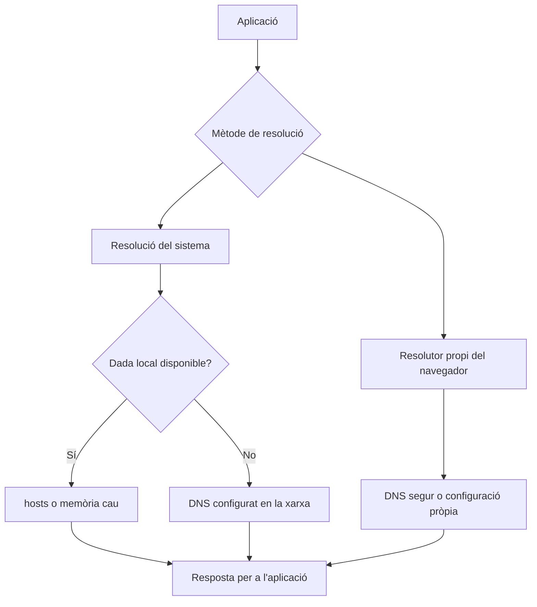

# 5. El client DNS

## 5.1. Configurar un client no és configurar una zona

En configurar el DNS d'una interfície es decideix **a quin resolutor es demanarà ajuda**. En configurar una zona s'estableixen **les dades que un servidor publica**. Són operacions diferents: instal·lar BIND no fa que tots els equips de la xarxa l'utilitzen automàticament.

El resolutor es pot rebre per DHCP o configurar manualment. En el laboratori, si el client ha de resoldre `aula.internal`, ha de consultar un servidor que conega eixa zona. Un DNS públic no coneix les zones privades creades únicament dins de VirtualBox.

La passarel·la per defecte i el servidor DNS també tenen funcions distintes. La primera transporta paquets cap a altres xarxes; el segon respon consultes de noms. Poden compartir IP perquè s'executen en el mateix equip, però no són el mateix servei.

## 5.2. El camí de resolució d'una aplicació



L'ordre exacte depén del sistema i de la configuració. Una aplicació que usa la resolució del sistema pot tindre un resultat diferent d'una consulta directa amb `dig`, perquè `dig` no consulta el fitxer `hosts` com ho fa habitualment la biblioteca del sistema.

## 5.3. Fitxer hosts i sufixos de cerca

En Linux, `/etc/hosts` permet associar una IP a un nom i àlies locals. En Windows, el fitxer és `C:\Windows\System32\drivers\etc\hosts`.

```text
192.168.0.200 intranet.aula.internal intranet
```

És útil per a una prova controlada, però pot amagar un error de DNS. L'equip on s'ha editat pot obrir el web i la resta no. Tampoc publica una delegació ni és visible per als servidors de Let's Encrypt.

Un **sufix de cerca** permet ampliar noms curts. Amb `aula.internal` com a domini de cerca, `intranet` pot acabar consultant `intranet.aula.internal`. Per a proves precises s'utilitzen noms complets, amb punt final quan es vulga evitar tota ampliació.

## 5.4. Linux actual

En sistemes amb `systemd-resolved`, `127.0.0.53` és habitualment el resolutor intermedi local. No és la IP del DNS extern. Per veure els servidors que realment usa cada interfície:

```bash
resolvectl status
resolvectl query intranet.aula.internal
readlink -f /etc/resolv.conf
cat /etc/resolv.conf
getent ahosts intranet.aula.internal
```

`getent` permet observar la resolució del sistema. La línia `hosts:` de `/etc/nsswitch.conf` indica els mecanismes que consulta el sistema i el seu ordre; `/etc/host.conf` no és una guia suficient per a entendre un Linux actual.

En equips gestionats per NetworkManager també és útil:

```bash
nmcli device show
```

En Ubuntu Server amb Netplan, la configuració persistent s'integra en el fitxer i la interfície existents:

```yaml
nameservers:
  addresses: [192.168.0.1]
  search: [aula.internal]
```

Aquest fragment **no és un fitxer Netplan complet**. S'ha de situar dins de la interfície corresponent i coordinar-lo amb el DNS rebut per DHCP i el gestor de xarxa. No s'ha d'esborrar la configuració de xarxa d'una instància remota per copiar-lo.

Editar `/etc/resolv.conf` directament sovint només produeix un canvi temporal perquè el gestor el torna a generar. Abans de modificar-lo, cal identificar qui el gestiona. Buidar la memòria cau local amb `sudo resolvectl flush-caches` no buida la d'un resolutor extern.

## 5.5. Windows

```powershell
ipconfig /all
Get-DnsClientServerAddress
Resolve-DnsName intranet.aula.internal
Resolve-DnsName intranet.aula.internal -Server 192.168.0.1 -Type A
nslookup intranet.aula.internal 192.168.0.1
```

S'ha de revisar la interfície activa, els DNS assignats i el sufix de cerca. `ipconfig /displaydns` mostra la memòria cau local i `ipconfig /flushdns` la buida; no esborra dades de la zona ni força Internet a refrescar-les.

## 5.6. Diversos DNS i navegadors

Configurar dos DNS no significa que el segon complete les zones que desconeix el primer. El sistema pot alternar-los segons disponibilitat i polítiques. Un `NXDOMAIN` és una resposta, no necessàriament una fallada que provoque consultar l'altre.

Per a una zona privada, tots els resolutors oferts al client han de poder resoldre-la de manera coherent. Barrejar un DNS del laboratori amb un DNS públic pot produir resultats intermitents.

Els navegadors poden tindre memòria cau pròpia i DNS sobre HTTPS. Si el navegador difereix de `dig` o de `getent`, cal revisar eixa configuració abans de modificar el servidor. En un entorn gestionat s'han de respectar les polítiques de xarxa del centre i utilitzar AWS per comparar resultats.

**Consulta:** [systemd-resolved](https://www.freedesktop.org/software/systemd/man/latest/systemd-resolved.service.html), [Netplan](https://netplan.readthedocs.io/en/stable/netplan-yaml/), [Resolve-DnsName](https://learn.microsoft.com/en-us/powershell/module/dnsclient/resolve-dnsname) i [ipconfig](https://learn.microsoft.com/en-us/windows-server/administration/windows-commands/ipconfig).
