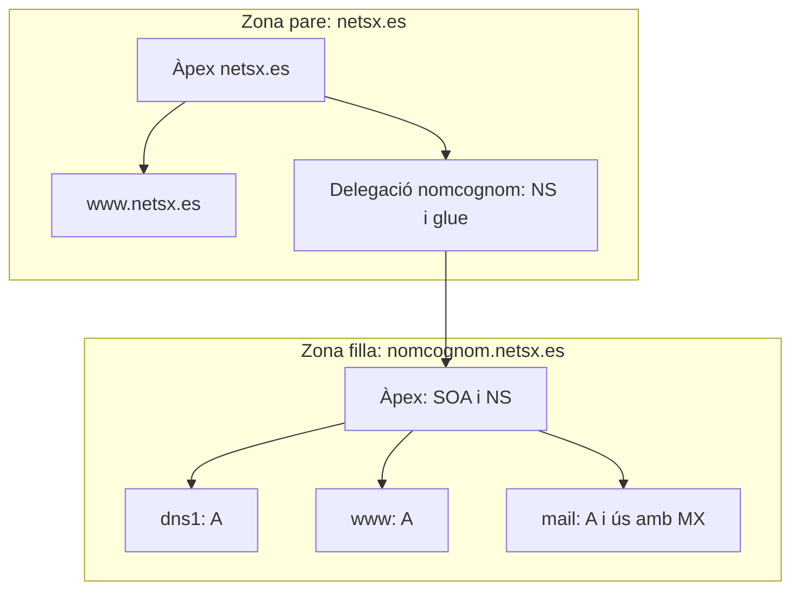

# 4. Zones, delegació i glue

## 4.1. Domini i zona no són sinònims

El **domini** és el subarbre lògic de noms. La **zona** és la part d'eixe arbre que s'administra i serveix conjuntament amb una autoritat determinada. Una zona inclou el seu àpex i els descendents no delegats; la informació de delegació marca on comença una altra zona.

Si `www.netsx.es` és un registre dins de `netsx.es`, no cal una zona separada per a `www`. Si `nomcognom.netsx.es` es delega a l'alumne, continua sent subdomini de `netsx.es`, però els seus registres passen a formar una zona amb SOA i NS propis.



## 4.2. Les dues parts d'una delegació

La delegació necessita informació coherent en **el pare i el fill**. Crear només la zona en el servidor de l'alumne no permet que Internet la descobrisca.

| Ubicació | Responsable | Contingut |
| --- | --- | --- |
| Zona `netsx.es` | Professorat o administrador del domini | NS de delegació i, quan cal, A/AAAA glue. |
| Zona `nomcognom.netsx.es` | Alumne | SOA, NS i registres autoritatius propis: `dns1`, `www`, etc. |
| Resolutor del client | Administrador del client o de la xarxa | Servidor al qual s'envien les consultes; no crea la delegació. |

Fragment **afegit a la zona pare**, no un fitxer de zona complet:

```dns
nomcognom.netsx.es.      IN NS dns1.nomcognom.netsx.es.
dns1.nomcognom.netsx.es. IN A  192.0.2.10
```

Fragment **de la zona filla**, que també necessita el seu SOA:

```dns
$ORIGIN nomcognom.netsx.es.
@    IN NS dns1.nomcognom.netsx.es.
dns1 IN A  192.0.2.10
www  IN A  192.0.2.20
```

Les IP són de documentació: en AWS es publiquen les Elastic IP reals. El pare envia cap al DNS de l'alumne; el servidor de l'alumne retorna la IP del web. **La IP del servidor DNS i la IP del servidor web tenen funcions diferents.**

## 4.3. Per què cal glue?

El NS delegat es diu `dns1.nomcognom.netsx.es`, un nom situat dins de la mateixa zona que es vol trobar. Sense cap adreça inicial apareix una dependència circular: per trobar el DNS cal preguntar al DNS que encara no es pot localitzar.

El **glue** és una adreça A/AAAA facilitada per la zona pare per trencar eixe cercle. En una referència apareix habitualment en `ADDITIONAL`. El registre de `dns1` també ha d'existir en la zona filla com a dada autoritativa. Les dues còpies han de coincidir; si canvia l'Elastic IP del DNS, cal actualitzar-les totes dues.

Si el NS està en un domini extern que ja es pot resoldre independentment, com `ns.proveidor.example`, aquesta dependència circular concreta no existeix. No s'ha de concloure que tots els A d'un domini són glue: ho determina el seu paper en una delegació.

## 4.4. Delegació, reenviament i rèplica

| Mecanisme | Configuració característica | Efecte |
| --- | --- | --- |
| Delegació | NS en el pare; glue quan correspon; zona autoritativa en el fill. | Permet descobrir l'autoritat a través de la jerarquia DNS. |
| Reenviament condicional | `type forward` i `forwarders` en un resolutor. | Eixe resolutor envia les consultes d'un domini a un servidor seleccionat. |
| Zona secundària | `type secondary`, servidor d'origen i transferència autoritzada. | Replica la mateixa zona en un altre servidor autoritatiu. |

**`type forward` no publica una delegació en Internet.** Una consulta pot funcionar perquè el resolutor del laboratori coneix una ruta particular, mentre que la delegació pública continua absent o mal configurada.

Un servidor que administra la zona filla és **primari de la seua zona**, encara que siga el segon servidor que s'ha instal·lat. No és secundari del pare pel fet d'estar més avall en la jerarquia.

## 4.5. Com es demostra la delegació?

En VirtualBox, `192.168.0.2` allotja una còpia local de `netsx.es` i delega la mateixa zona personal que més avant es publicarà. El fill és `192.168.0.1`.

```bash
# El pare ha de donar una referència cap a nomcognom.netsx.es.
dig @192.168.0.2 www.nomcognom.netsx.es A +norecurse

# El fill ha de respondre amb autoritat.
dig @192.168.0.1 www.nomcognom.netsx.es A +norecurse

# El resolutor que usa el client ha d'obtindre la resposta final.
dig @192.168.0.2 www.nomcognom.netsx.es A
```

S'ha d'inspeccionar la resposta completa. En el pare s'esperen els NS de delegació i el glue; en el fill, el registre A i `aa`. El comportament visible del pare pot dependre de dades ja presents en memòria cau; cal contrastar la configuració i l'autoritat, no únicament comptar respostes.

La [píndola de subzona](../pindoles-formatives/configuracio-de-subzona-al-servei-dns-a-ubuntu-24.04.md) explica com muntar els dos servidors. En el cas públic també es comprova el recorregut amb `dig +trace` i un resolutor extern. Fer `dig @IP_DNS_ALUMNE` **evita el descobriment del servidor** i no prova per si sol que la delegació estiga publicada.

## 4.6. Delegació inversa i DNSSEC

Delegar `nomcognom.netsx.es` no delega automàticament cap xarxa IP. Si els equips continuen dins del mateix `/24`, la zona inversa pot continuar administrada per un únic servidor, amb PTR cap a noms de les dues zones directes. Duplicar la mateixa zona inversa independentment en dos servidors provoca respostes incoherents. Per a subxarxes menors de `/24` hi ha tècniques específiques, com les descrites en el RFC 2317.

En una zona signada, el registre DS del pare connecta amb la informació DNSSEC del fill. Un DS incorrecte pot fer fallar la validació. No s'ha d'afegir DS com si fora glue, ni desactivar la validació del client com a solució general a un error.

## Errors que s'han d'evitar

- Posar la IP del web en el glue del DNS.
- Escriure una IP com a destinació d'un NS.
- Configurar NS només en el fill i oblidar el pare.
- Publicar un NS que apunta a una zona que el servidor no ha carregat: delegació incorrecta o *lame delegation*.
- Crear un reenviament local i presentar-lo com a prova de delegació pública.
- Confondre zona filla, servidor secundari i zona inversa.

**Consulta:** [RFC 1034](https://www.rfc-editor.org/rfc/rfc1034), [RFC 9471, glue](https://www.rfc-editor.org/rfc/rfc9471.html), [RFC 2317](https://www.rfc-editor.org/rfc/rfc2317) i [RFC 9499](https://datatracker.ietf.org/doc/html/rfc9499).
