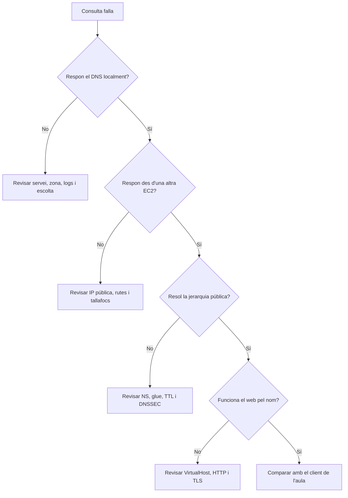

# 8. Consultes i diagnòstic DNS

## 8.1. Abans de començar

Una prova útil ha d'indicar **origen, servidor consultat, nom, tipus i resultat esperat**. S'ha de distingir una resposta negativa d'una absència de resposta i una resolució local d'una delegació pública.

En Ubuntu, `sudo apt install dnsutils` instal·la les ferramentes habituals. Els exemples amb IP `192.0.2.10` són de documentació: cal substituir-la per la IP real del DNS. `nomcognom` també s'ha d'adaptar. Per aïllar problemes de resolució del servidor, després de `@` s'utilitza la seua IP.

## 8.2. Consultes amb dig

Sintaxi bàsica:

```text
dig @SERVIDOR NOM TIPUS OPCIONS
```

Sense `@SERVIDOR`, s'utilitza la configuració de resolució que consulta `dig`; sense tipus, la consulta habitual és A. `dig` significa *Domain Information Groper*. Permet veure les dades del protocol amb més detall que una prova amb navegador.

```bash
dig www.nomcognom.netsx.es A
dig @192.0.2.10 nomcognom.netsx.es SOA +norecurse
dig @192.0.2.10 nomcognom.netsx.es NS +norecurse
dig @192.0.2.10 www.nomcognom.netsx.es A +norecurse
dig @192.0.2.10 www.nomcognom.netsx.es A +tcp +norecurse
dig nomcognom.netsx.es MX
dig _acme-challenge.www.nomcognom.netsx.es TXT
dig -x 192.0.2.20
dig +trace www.nomcognom.netsx.es A
```

| Opció | Utilitat | Límit de la prova |
| --- | --- | --- |
| `+short` | Mostra un resultat breu. | Oculta codi d'estat, autoritat i seccions importants. |
| `+noall +answer` | Mostra únicament la secció de resposta. | Un resultat buit necessita una consulta completa per interpretar-se. |
| `+norecurse` | No sol·licita recursió. | No obliga a buidar memòria cau ni identifica per si sol una autoritat. |
| `+tcp` | Utilitza TCP. | Que TCP funcione no prova que UDP funcione. |
| `+notcp +ignore` | Consulta per UDP i evita repetir per TCP una resposta truncada. | Útil quan es vol comprovar UDP expressament. |
| `+trace` | Segueix referències des de l'arrel. | Necessita eixida DNS directa; no reprodueix totes les polítiques del resolutor habitual. |
| `+time=2 +tries=1` | Limita espera i intents. | Un temps curt pot donar falsos negatius en xarxes lentes. |
| `-x IP` | Construeix la consulta inversa. | El PTR depén de la zona inversa, no del registre A. |
| `-f fitxer` | Llig consultes d'un fitxer. | Cada línia ha de contindre una consulta vàlida. |
| `-b IP_LOCAL` | Selecciona una adreça local d'origen. | L'adreça ha d'estar assignada a l'equip. |

`+comments`, `+nocomments`, `+stats` i `+nostats` controlen la informació mostrada. Per a una evidència inicial és preferible conservar la resposta completa. `ANY` no garanteix l'inventari de tots els registres d'una zona: es consulten els tipus necessaris explícitament.

## 8.3. Interpretar una resposta

Exemple il·lustratiu, no captura d'un servei real:

```text
;; ->>HEADER<<- opcode: QUERY, status: NOERROR, id: 1234
;; flags: qr aa; QUERY: 1, ANSWER: 1, AUTHORITY: 0, ADDITIONAL: 1
;; QUESTION SECTION:
;www.nomcognom.netsx.es. IN A
;; ANSWER SECTION:
www.nomcognom.netsx.es. 300 IN A 192.0.2.20
;; SERVER: 192.0.2.10#53
```

- `status`: resultat del processament; cal revisar-lo abans de donar la prova per correcta.
- `qr`: és una resposta.
- `aa`: el servidor respon amb autoritat.
- `rd`: s'ha demanat recursió; no significa que s'haja pogut realitzar.
- `ra`: el servidor anuncia disponibilitat de recursió; no acredita la delegació.
- `ad`: un resolutor validador indica dades autenticades; la confiança també depén del resolutor i del canal.
- `tc`: resposta truncada; cal comprovar TCP.
- `SERVER`: servidor al qual la ferramenta atribueix la resposta. En una xarxa amb intermediació, no és prova suficient d'absència d'intercepció.

El TTL d'una resposta en memòria cau sol disminuir amb el temps. Una resposta autoritativa acostuma a mostrar el TTL configurat. `Query time` mesura una consulta concreta; no és suficient per proclamar quin DNS és sempre més ràpid.

## 8.4. host i nslookup

`host` és pràctic per a consultes breus:

```bash
host www.nomcognom.netsx.es
host -t NS nomcognom.netsx.es
host -t MX nomcognom.netsx.es
host www.nomcognom.netsx.es 192.0.2.10
host 192.0.2.20
```

La IP sola en l'última ordre produeix una consulta inversa. `-t` selecciona el tipus i `-R` el nombre de reintents. Les opcions que demanen transferències o respostes ANY no s'han d'interpretar com una enumeració garantida del domini; cal consultar el manual instal·lat.

`nslookup` està disponible en Linux i Windows. Es pot usar amb una única consulta o de forma interactiva:

```text
nslookup -type=SOA nomcognom.netsx.es 192.0.2.10
nslookup
> server 192.0.2.10
> set type=NS
> nomcognom.netsx.es
> set type=A
> www.nomcognom.netsx.es
> exit
```

El text `Non-authoritative answer` no indica una fallada: és habitual en una resposta d'un resolutor. La indicació `#53` identifica el port, no prova que s'haja utilitzat TCP. No s'ha de donar per desapareguda una ferramenta perquè un document antic prediga que deixarà d'existir.

## 8.5. Ordre de diagnòstic



1. Validar sintaxi, càrrega de la zona i servei.
2. Consultar SOA i A directament a BIND, primer localment.
3. Repetir contra la IP pública des d'una altra instància; comprovar UDP i TCP.
4. Consultar el pare i després un resolutor recursiu; comprovar `+trace` des d'AWS.
5. Revisar el client i les memòries cau si difereix de la resolució externa.
6. Comprovar HTTP i HTTPS només quan els registres del web són coherents.

## 8.6. Si falla des de la xarxa de Conselleria

!!! warning "Atenció"

    Les restriccions, el filtratge o la intermediació DNS de la xarxa del centre poden produir temps d'espera, respostes diferents o fallades en `+trace`. **S'han de repetir les proves directament en una terminal de la instància Ubuntu/Linux d'AWS**, accedint-hi per SSH o pel mecanisme habilitat en el laboratori. No cal esperar a disposar d'una tercera màquina per començar la comparació.


Per consultar el DNS públic es pot utilitzar la instància web com a client. Per comprovar accés públic al web s'utilitza un altre origen, com la instància DNS, o una instància de proves disponible. Una tercera EC2 és opcional si aporta independència i el laboratori ho permet; no és un requisit automàtic.

Es repeteix **la mateixa consulta al mateix servidor** des dels dos orígens, amb pocs minuts de diferència, i s'anota el resultat. No es pot atribuir qualsevol fallada al tallafoc del centre sense aquesta comparació. Tampoc es pot assegurar quin dispositiu o política concreta la causa només perquè els resultats siguen diferents.

| Origen | Prova | Dades que s'han d'anotar |
| --- | --- | --- |
| Equip de l'aula | Consulta directa a la IP pública del DNS | Ordre completa, estat, resposta o temps d'espera. |
| Instància web AWS | La mateixa consulta directa | A esperat, `aa`, UDP i TCP. |
| Instància Linux AWS | Consulta amb resolutor i `+trace` | NS/glue del pare i resposta final. |
| Origen diferent del web | HTTP i HTTPS pel nom | Codi HTTP i verificació del certificat. |

**Interpretació:** si només falla a l'aula, hi ha indicis d'una diferència de xarxa o de configuració del client. Si també falla directament des d'AWS, s'ha de continuar revisant servidor i publicació. Si les consultes directes funcionen però la pública no, s'ha d'investigar la delegació, la memòria cau o la validació.

## 8.7. Separar DNS del servidor web

Per provar el VirtualHost sense dependre del resolutor es pot forçar temporalment una IP només per a una ordre:

```bash
curl --resolve www.nomcognom.netsx.es:80:192.0.2.20 \
  -I http://www.nomcognom.netsx.es

curl --resolve www.nomcognom.netsx.es:443:192.0.2.20 \
  -I https://www.nomcognom.netsx.es
```

Cal substituir la IP. `--resolve` conserva el nom HTTP i el nom TLS, però evita la resolució DNS ordinària. **Serveix per aïllar el web; no prova la delegació.** No s'utilitza `-k` per acreditar confiança del certificat.

`ping` barreja resolució i ICMP. Si mostra la IP però no rep resposta, DNS pot haver funcionat i ICMP estar filtrat. No s'ha de reiniciar BIND únicament perquè no respon un ping.

## 8.8. Taula de símptomes

| Símptoma | Comprovació següent |
| --- | --- |
| `NXDOMAIN` | Ortografia, zona consultada, registre creat i memòria cau negativa. |
| `NOERROR` sense A | Tipus de registre, CNAME, NODATA o referral; llegir totes les seccions. |
| `REFUSED` | ACL de consulta, recursió demanada i zona autoritativa carregada. |
| `SERVFAIL` | Logs, accessibilitat de tots els NS, delegació i DNSSEC. |
| Temps d'espera | Escolta del servei, IP, UDP/TCP, Security Groups i comparació amb AWS. |
| IP antiga | Consultar directament l'autoritatiu i revisar TTL, sèrie i secundaris. |
| A correcte però navegador falla | AAAA, DNS del navegador, VirtualHost, ports 80/443 i TLS. |
| PTR inesperat en AWS | Autoritat real de la zona inversa i permisos del proveïdor. |

Una evidència ha de mostrar el que s'ha observat i la conclusió que permet extraure. No s'ha de presentar una captura local com a prova de publicació mundial.

**Consulta:** [manuals de dig, host i nslookup](https://bind9.readthedocs.io/en/stable/manpages.html), [curl --resolve](https://curl.se/docs/manpage.html#--resolve), [RFC 8482, respostes ANY](https://www.rfc-editor.org/rfc/rfc8482) i [DNS en Ubuntu](https://ubuntu.com/server/docs/how-to/networking/install-dns/).
