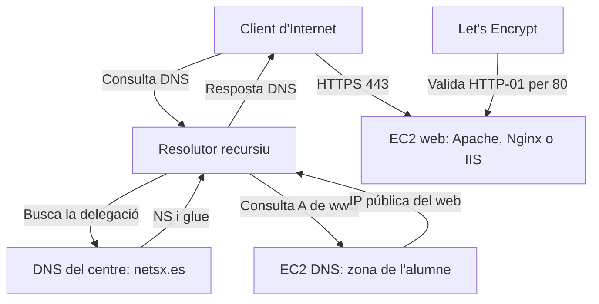

# 7. De netsx.es a HTTPS

## 7.1. El repte del centre

El centre administra `netsx.es`. Cada alumne rep una subzona amb nom i primer cognom, sense espais ni accents, segons el nom acordat: `nomcognom.netsx.es`. S'utilitza el mateix nom que en les [proves de VirtualBox](../pindoles-formatives/configuracio-de-subzona-al-servei-dns-a-ubuntu-24.04.md). En aquesta fase s'anuncien les adreces públiques dels serveis i el professorat crea la delegació en la zona pública.

L'objectiu és que un client d'Internet descobrisca el DNS de l'alumne, obtinga la IP del seu web i establisca una connexió HTTPS amb un certificat vàlid per al nom utilitzat.

| Element | Nom de l'exemple | Adreça que correspon |
| --- | --- | --- |
| Zona delegada | `nomcognom.netsx.es` | No és una màquina ni té obligatòriament un A. |
| Servidor autoritatiu | `dns1.nomcognom.netsx.es` | IP pública del DNS. |
| Servidor web | `www.nomcognom.netsx.es` | IP pública del web. |
| Web sense www, si es publica | `nomcognom.netsx.es` | IP pública del web mitjançant A en `@`. |

## 7.2. Arquitectura i responsabilitats



El navegador no passa el trànsit web pel servidor DNS. Una vegada obtinguda la IP, es connecta al servidor web. El certificat s'instal·la en el servidor web, no en BIND.

En el DNS es publiquen les IP públiques reals. Les IP privades serveixen per a comunicació interna i diagnòstic dins de la VPC. Una IP pública canviant obliga a revisar registres i glue; s'utilitzen les Elastic IP previstes en la pràctica, si el laboratori ho permet.

## 7.3. Preparar la zona filla

Exemple complet per estudiar l'estructura; `192.0.2.10` i `192.0.2.20` s'han de substituir:

```dns
$ORIGIN nomcognom.netsx.es.
$TTL 300
@ IN SOA dns1.nomcognom.netsx.es. hostmaster.nomcognom.netsx.es. (
    2026111101 3600 600 604800 300
)
     IN NS dns1.nomcognom.netsx.es.
dns1 IN A  192.0.2.10
www  IN A  192.0.2.20
@    IN A  192.0.2.20
```

El contacte SOA ha d'adaptar-se a una adreça de gestió vàlida. Es valida el fitxer i es comprova que el servidor respon amb `aa` per al SOA i el web. S'ha de mantindre la recursió pública desactivada i publicar UDP/TCP 53.

## 7.4. Demanar i comprovar la delegació

Una vegada funcionen les consultes directes, s'entrega al professorat:

1. Nom exacte de la subzona.
2. FQDN del servidor DNS i IP pública corresponent.
3. IP pública del web.
4. Evidència de SOA, NS i A obtinguda des d'una altra instància.

El responsable del pare afegeix els NS i el glue descrits en el [capítol de delegació](delegacio-i-glue.md). **La delegació no es crea canviant el DNS de la targeta de xarxa ni afegint únicament NS al servidor de l'alumne.**

Des d'una instància Ubuntu/Linux d'AWS:

```bash
dig nomcognom.netsx.es NS
dig nomcognom.netsx.es SOA
dig www.nomcognom.netsx.es A
dig www.nomcognom.netsx.es AAAA
dig +trace www.nomcognom.netsx.es A
```

`+trace` necessita accedir directament als servidors de la jerarquia; per això és especialment important repetir-lo des d'AWS si falla a l'aula. La inexistència d'AAAA és acceptable si no s'ha configurat IPv6. Si existeix un AAAA, ha de funcionar.

## 7.5. DNS, HTTP i TLS: tres comprovacions

| Capa | Prova | Què acredita |
| --- | --- | --- |
| DNS | `dig www.nomcognom.netsx.es A` | El resolutor retorna l'adreça publicada. |
| HTTP | `curl -I http://www.nomcognom.netsx.es` | El web respon per al nom, al port 80. |
| HTTPS | `curl -I https://www.nomcognom.netsx.es` | Es pot establir TLS i validar el certificat amb les autoritats de confiança del client. |

Una resposta HTTP 404 demostra que hi ha un servidor HTTP responent, però no que el contingut o la ruta del repte siguen correctes. Una resposta 200 a la IP tampoc garanteix que el VirtualHost del nom estiga configurat.

El certificat ha d'incloure **cada nom que s'utilitze**. Un certificat per a `www.nomcognom.netsx.es` no cobreix automàticament `nomcognom.netsx.es`. HTTPS utilitza el nom en la selecció del lloc i la validació del certificat; substituir el nom per la IP no és una comprovació equivalent.

## 7.6. Comprovar el control del domini amb ACME

Let's Encrypt és una autoritat de certificació. Un client ACME, com Certbot, automatitza la sol·licitud i la renovació. Per emetre el certificat ha de demostrar-se el control dels noms sol·licitats.

| Repte | Què s'ha de publicar | Aplicació |
| --- | --- | --- |
| HTTP-01 | Fitxer de validació en `http://NOM/.well-known/acme-challenge/TOKEN`, accessible pel port 80. | És l'opció de la pràctica web. |
| DNS-01 | TXT en `_acme-challenge.NOM`, amb el valor indicat pel client ACME. | Permet validar amb DNS, inclosos comodins; necessita una estratègia d'automatització. |

Amb HTTP-01, Let's Encrypt consulta el DNS públic i accedeix al servidor des de la seua infraestructura. Editar `hosts` en l'ordinador de l'alumne no li canvia la resolució. Una delegació trencada no s'arregla fent que el navegador local veja el web.

DNS-01 demostra control amb TXT i no requereix un web públic al port 80 per validar el nom. Tampoc configura per si mateix el servei HTTPS. Un TXT afegit manualment pot servir per a una prova, però la renovació desatesa necessita un mecanisme que l'actualitze.

## 7.7. Exemple orientatiu amb Apache i Certbot

Sobre el servidor web Ubuntu, amb Apache i el VirtualHost de `www.nomcognom.netsx.es` ja configurats:

```bash
sudo apt update
sudo apt install certbot python3-certbot-apache
sudo apache2ctl configtest
sudo certbot --apache -d www.nomcognom.netsx.es
```

S'han de seguir les indicacions del client, utilitzar un correu de contacte adequat i revisar la configuració resultant. Si també es vol incloure el nom sense `www`, cal que el seu A i el VirtualHost funcionen abans de sol·licitar-lo amb un altre `-d`.

Per a Nginx o IIS s'utilitza un client o complement ACME adequat; les ordres d'Apache no s'han de copiar en un altre servidor web. No cal instal·lar Apache en la instància DNS.

El servidor web necessita **80/TCP per a HTTP-01** i **443/TCP per a HTTPS**, tant en el Security Group com en el tallafoc local, si està actiu. No s'ha de limitar HTTP-01 només a la IP del centre. No s'han de fer intents reiterats d'emissió mentre continuen fallant DNS o HTTP; per a assajos repetits s'utilitza l'entorn de proves d'ACME, que genera certificats no confiables per al navegador.

## 7.8. Renovació i evidències

```bash
sudo certbot certificates
sudo certbot renew --dry-run
systemctl list-timers --all | grep -i certbot
curl -I https://www.nomcognom.netsx.es
```

La instal·lació pot automatitzar la renovació amb un temporitzador o un altre planificador; s'ha de comprovar quin mecanisme existeix. `--dry-run` verifica el procés de renovació, no amplia la vigència del certificat de producció. Una instància parada o una IP canviada pot impedir renovacions.

S'entreguen nom, emissor i dates del certificat, prova HTTPS sense ignorar errors, prova de renovació i evidències DNS. **No s'entrega la clau privada.** `curl -k` omet comprovacions de confiança i no és una evidència de certificat vàlid.

**Consulta:** [tipus de reptes de Let's Encrypt](https://letsencrypt.org/docs/challenge-types/), [guia de Certbot](https://eff-certbot.readthedocs.io/en/stable/using.html), [entorn de proves](https://letsencrypt.org/docs/staging-environment/) i [Elastic IP en AWS](https://docs.aws.amazon.com/AWSEC2/latest/UserGuide/elastic-ip-addresses-eip.html).
