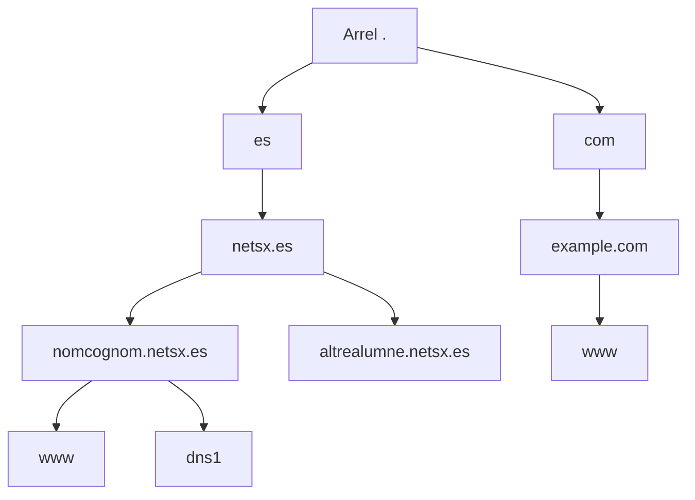

# 1. Noms, jerarquia i organització

## 1.1. Per què cal un servei de noms?

Els equips intercanvien paquets utilitzant adreces IP. Les persones, en canvi, recorden millor noms com `www.example.com`. DNS separa el nom del servei de l'adreça amb què s'hi arriba: si el servei canvia de servidor, es pot actualitzar la informació DNS i conservar el nom.

Un nom no identifica necessàriament una única màquina. Diversos noms poden compartir IP, i un mateix nom pot tindre diverses adreces. Una màquina també pot oferir diversos serveis amb noms diferents. Per això, la relació nom–IP no és obligatòriament d'un a un.

En els primers entorns de xarxa s'intercanviava un fitxer centralitzat `HOSTS.TXT`. A mesura que creixia la xarxa, resultava difícil mantindre'l coherent, distribuir-ne els canvis i evitar conflictes de noms. DNS va introduir una estructura **jeràrquica, distribuïda i delegable**. Les especificacions inicials són els RFC 882 i 883 de 1983; els RFC 1034 i 1035 de 1987 en constitueixen la base clàssica, ampliada posteriorment.

El fitxer `hosts` encara és útil per a correspondències locals, però editar-lo en un ordinador no publica informació en Internet.

## 1.2. Domini, subdomini, nom d'equip i URL

Un **domini** és una part de l'arbre de noms situada davall d'un node. Un **subdomini** és un domini contingut en un altre. Les paraules primari i secundari aplicades a servidors no s'han de confondre amb els nivells d'un nom.

| Expressió | Significat |
| --- | --- |
| `es` | Domini de primer nivell o TLD. |
| `netsx.es` | Domini del centre dins de `.es`. |
| `nomcognom.netsx.es` | Subdomini que s'assigna a l'alumne. |
| `www.nomcognom.netsx.es` | Nom que s'utilitza per al servei web dins d'eixe subdomini. |
| `https://www.nomcognom.netsx.es/apunts` | URL: inclou esquema, nom del servidor i camí. |

DNS consulta el nom `www.nomcognom.netsx.es`; no resol `https://` ni el camí `/apunts`. El navegador aplica després les regles d'HTTP i TLS. `www` és una etiqueta convencional i no un requisit de DNS: un web pot utilitzar el nom de la zona sense `www`.

## 1.3. FQDN i punt final

Un **FQDN** és un nom complet, sense dependència d'un sufix de cerca. En la seua forma absoluta acaba amb el punt que representa l'arrel:

```text
www.nomcognom.netsx.es.
```

Es llig de dreta a esquerra: arrel `.`, TLD `es`, `netsx`, `nomcognom` i `www`. En navegadors és habitual ometre el punt final. En fitxers de zona és molt important: `dns1.example.com.` és absolut, mentre que `dns1.example.com` pot rebre l'origen de la zona i acabar com `dns1.example.com.example.com.`.

**El punt final no obliga a començar una consulta en els servidors arrel.** Indica que el nom és absolut; el resolutor encara pot respondre des de la memòria cau.

## 1.4. L'arbre de noms



Cada branca pot ser administrada per una organització diferent. **Un punt separa etiquetes, però no implica necessàriament una delegació.** La frontera administrativa apareix quan es delega una zona mitjançant registres NS.

Els servidors arrel coneixen les delegacions dels TLD; no contenen totes les IP de tots els webs. Hi ha 13 identitats de servei arrel, de la A a la M, desplegades en moltes instàncies mitjançant *anycast*. No s'ha d'interpretar que Internet depén de només 13 ordinadors físics.

## 1.5. Regles bàsiques per als noms

Per als noms d'equip de les pràctiques s'utilitzen lletres ASCII, dígits i guions; no s'inicia ni es tanca una etiqueta amb guió. S'eviten espais, accents i guions baixos en noms d'host. Els noms internacionals existeixen, però utilitzen mecanismes IDNA i no són necessaris en aquesta unitat.

Cada etiqueta pot ocupar fins a 63 octets; el nom DNS complet té un màxim de 255 octets en la codificació del protocol. DNS no diferencia majúscules i minúscules en la comparació habitual de noms. En canvi, un camí web sí que pot distingir-les.

El guió baix apareix legítimament en noms de registres de servei, com `_acme-challenge` o `_sip._tcp`: no són noms d'host convencionals. `.local` està reservat a mDNS i pot ocasionar confusions si s'usa com a zona DNS unicast. Per a exemples públics s'utilitzen dominis reservats com `example.com`; per a la pràctica pública s'utilitza la subzona assignada de `netsx.es`.

## 1.6. Qui administra què?

| Actor | Funció |
| --- | --- |
| ICANN | Coordina polítiques i elements del sistema global d'identificadors. |
| Funcions IANA | Mantenen registres tècnics, inclosa la informació de delegació de l'arrel. |
| Registre d'un TLD (*registry*) | Administra el registre d'eixe domini de primer nivell. En `.es`, la gestió correspon a Red.es. |
| Agent registrador (*registrar*) | Tramita el registre i la gestió contractual d'un domini. |
| Titular del domini | Decideix l'ús del domini i qui en gestiona el DNS. |
| Proveïdor DNS autoritatiu | Publica les zones i les respostes autoritatives. |
| Proveïdor de hosting | Allotja el web o altres aplicacions. |

Una empresa pot oferir diverses d'aquestes funcions, però són serveis diferents. Registrar un domini no crea automàticament un web; contractar hosting tampoc delega per si mateix una zona. Les assignacions d'adreces IP segueixen una organització pròpia amb registres regionals: no les fa el registrador pel fet de vendre un domini.

**Aplicació al centre:** l'alumnat no compra `nomcognom.netsx.es`; el responsable de `netsx.es` delega eixa part de l'arbre i l'alumne n'administra els registres.

## Per comprovar la comprensió

S'ha de poder separar el nom DNS de la resta d'una URL, identificar el domini pare i explicar per què canviar `/etc/hosts` no equival a publicar una zona.

**Consulta:** [RFC 1034](https://www.rfc-editor.org/rfc/rfc1034), [RFC 1035](https://www.rfc-editor.org/rfc/rfc1035), [TLD d'IANA](https://www.iana.org/domains/root/db), [servidors arrel](https://www.iana.org/domains/root/servers) i [Dominios.es](https://www.dominios.es/).
