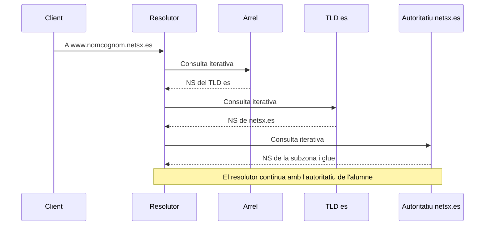

# 2. Resolució, transport i memòria cau

## 2.1. Els participants

L'aplicació necessita informació d'un nom. El **client resolutor** del sistema (*stub resolver*) demana ajuda a un **resolutor recursiu**. Aquest últim pot tindre la resposta en memòria cau o buscar-la consultant altres servidors. Un **servidor autoritatiu** publica la informació de les zones que administra.

| Rol | Què fa | Què no implica |
| --- | --- | --- |
| Client resolutor | Envia la consulta per a l'aplicació. | Que busque personalment en tota la jerarquia. |
| Resolutor recursiu | Obté una resposta final per al client i pot guardar-la en memòria cau. | Que siga autoritatiu del domini consultat. |
| Autoritatiu | Respon amb dades de la zona que serveix. | Que resolga dominis aliens per a qualsevol client. |
| Reenviador | Rep consultes que un altre servidor li remet. | Que siga el titular de les zones consultades. |

Un mateix programa pot exercir diversos rols. En el laboratori, el BIND que serveix `aula.internal` pot també resoldre noms externs per als clients. En AWS convé dedicar el servidor públic a la funció autoritativa.

## 2.2. Recursió i iteració

Una consulta **recursiva** demana al servidor que obtinga la resposta final o comunique la impossibilitat de resoldre. En la **resolució iterativa**, el resolutor va consultant servidors que poden respondre o indicar on continuar mitjançant una referència (*referral*).

Exemple simplificat sense dades prèvies en memòria cau:

El resolutor consulta després el servidor de `nomcognom.netsx.es`, obté el registre A de `www` i retorna la resposta al client. Si hi ha un CNAME, pot necessitar continuar amb el nom de destinació. Les implementacions també poden reduir la informació enviada als nivells superiors mitjançant minimització de consultes.

**Els servidors arrel no van telefonant als altres servidors en nom del client.** És el resolutor qui segueix les referències. Si ja coneix els NS de la zona o disposa del registre en memòria cau, es poden ometre passos.

## 2.3. Què conté una consulta i una resposta?

La pregunta combina un **nom**, un **tipus** i una **classe**. En la unitat s'utilitza la classe `IN`, corresponent a Internet. Preguntar per `A` i preguntar per `MX` són consultes diferents encara que el nom siga igual.

La resposta inclou una capçalera i seccions:

| Secció | Funció |
| --- | --- |
| `QUESTION` | Recorda el nom i el tipus demanats. |
| `ANSWER` | Registres que responen a la consulta. |
| `AUTHORITY` | Informació d'autoritat, delegació o SOA per a respostes negatives. |
| `ADDITIONAL` | Dades complementàries, com adreces glue o informació EDNS. |

La presència d'un NS en `AUTHORITY` no significa que s'haja resolt el registre A del web. Pot ser una indicació de quin servidor s'ha de consultar a continuació.

## 2.4. UDP i TCP: tots dos al port 53

El DNS clàssic utilitza **UDP/53 i TCP/53**. Moltes consultes comencen per UDP perquè evita l'establiment d'una connexió. Si la resposta no cap, el servidor pot indicar truncament amb `TC`, i el client repetir-la per TCP. EDNS permet anunciar capacitats i grandàries majors que el límit original de 512 octets, però no elimina la necessitat de TCP.

TCP també s'utilitza en transferències AXFR i en consultes ordinàries. Per tant, **no és correcte obrir només UDP/53** ni afirmar que TCP serveix exclusivament per a transferir zones. El port de destinació del servidor és 53; el client normalment usa un port d'origen efímer.

Altres transports, com DNS sobre TLS o HTTPS, poden xifrar el tram entre client i resolutor. No s'han de confondre amb DNSSEC ni amb el certificat HTTPS del web que s'està visitant.

## 2.5. TTL i memòria cau positiva

El **TTL** expressa durant quant de temps es pot conservar una dada DNS en memòria cau. Redueix consultes repetides i latència. Cada capa pot tindre la seua pròpia memòria cau: aplicació, sistema i resolutor.

Exemple: a les 10.00 un resolutor guarda `www → 192.0.2.20` amb TTL 300. A les 10.01 s'actualitza l'autoritatiu a `192.0.2.30`. El resolutor encara pot contestar amb l'adreça anterior fins que caduque la còpia, aproximadament a les 10.05. Un altre resolutor que consulte després del canvi pot veure la nova IP abans.

Quan es parla de **propagació DNS**, habitualment es tracta de la caducitat de còpies en memòria cau i, si existeixen, de la sincronització dels servidors autoritatius. No hi ha una còpia global del DNS que s'envie simultàniament a tot Internet, ni un termini universal de 24 o 48 hores.

Per a una migració es pot reduir el TTL amb antelació i esperar que caduque el TTL anterior abans del canvi. Reduir-lo després no modifica les respostes que altres resolutors ja havien guardat. Valors molt baixos faciliten el laboratori, però augmenten consultes i dependència del servidor.

## 2.6. Memòria cau negativa i errors

També es pot guardar temporalment que un nom o un tipus de registre no existeix. Això explica que una alta recent continue retornant una resposta negativa durant un temps.

| Resultat | Interpretació |
| --- | --- |
| `NOERROR` amb resposta | La consulta s'ha processat i hi ha registres de resposta. |
| `NOERROR` sense el tipus demanat, amb SOA | Pot ser **NODATA**: el nom existeix però no té eixe tipus. No s'ha de confondre amb un referral. |
| `NXDOMAIN` | El nom consultat no existeix segons la resposta rebuda. |
| `SERVFAIL` | El servidor no ha pogut completar la resolució; cal investigar delegació, accessibilitat o validació. |
| `REFUSED` | El servidor ha rebut la consulta però la política no li permet contestar-la. |
| Temps d'espera esgotat | No s'ha rebut resposta a temps; no equival a `NXDOMAIN`. |

El TTL de la resposta negativa es deriva del menor entre el TTL del SOA i el camp MINIMUM del SOA. **MINIMUM no és el TTL per defecte de tots els registres**: en una zona BIND moderna, eixe valor per defecte es defineix amb `$TTL`.

## 2.7. Autoritat, validació i confidencialitat

Una resposta amb el bit `AA` prové d'un servidor que es declara autoritatiu per a les dades pertinents. Una resposta d'un resolutor en memòria cau és normalment no autoritativa i pot ser perfectament correcta. `AA` no és una prova criptogràfica d'identitat.

**DNSSEC** permet validar autenticitat i integritat mitjançant signatures i una cadena de confiança; no xifra les consultes. Un resolutor validador pot retornar `SERVFAIL` si la cadena falla. **DoH/DoT** protegeixen el transport en el tram configurat. **HTTPS** protegeix la connexió amb el web. Són funcions diferents i complementàries.

**Consulta:** [RFC 9499, terminologia](https://datatracker.ietf.org/doc/html/rfc9499), [RFC 7766, TCP](https://www.rfc-editor.org/rfc/rfc7766), [RFC 6891, EDNS](https://www.rfc-editor.org/rfc/rfc6891) i [RFC 2308, memòria cau negativa](https://datatracker.ietf.org/doc/html/rfc2308).
