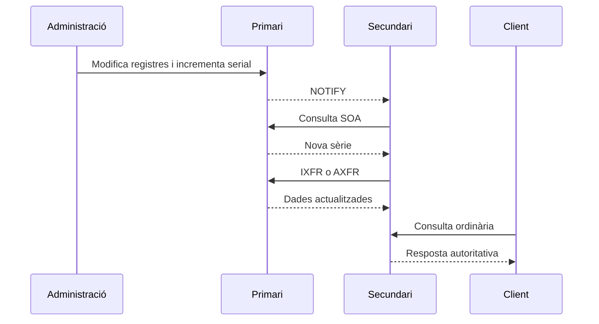

# 6. El servidor DNS

## 6.1. Autoritatiu primari, secundari i memòria cau

Un **primari** obté les dades de la zona des de la seua font de configuració. Un **secundari** n'obté una còpia per transferència. Tots dos poden donar respostes autoritatives. El secundari no és una còpia amb menys validesa ni un servidor que només respon quan falla el primari.

Un servidor de **memòria cau** conserva respostes obtingudes durant la resolució, però no es converteix en autoritatiu de les zones consultades. Una mateixa instància pot ser primària d'una zona i secundària d'una altra.

En un servei real convé disposar de més d'un autoritatiu, en infraestructures independents. En el laboratori es pot començar amb un únic servidor per entendre el procés, assumint que la seua caiguda interromp el servei de la zona.

## 6.2. Com es replica una zona?

El secundari consulta el SOA per comprovar la sèrie. Si hi ha una versió posterior, pot obtindre una transferència completa **AXFR** o incremental **IXFR**. El primari pot enviar **NOTIFY** per avisar d'un canvi; l'avís no substitueix la transferència.



La transferència s'ha de permetre només als secundaris autoritzats, preferiblement autenticada amb TSIG quan corresponga. TSIG autentica transaccions entre servidors; no és DNSSEC. Si el secundari no pot refrescar durant el temps `expire`, la còpia deixa de ser vàlida per continuar servint-la com a autoritativa.

## 6.3. Fitxers de BIND en Ubuntu

| Fitxer o element | Funció habitual |
| --- | --- |
| `/etc/bind/named.conf` | Configuració principal i inclusions. |
| `/etc/bind/named.conf.options` | Opcions generals, escolta, recursió i permisos. |
| `/etc/bind/named.conf.local` | Declaracions de les zones locals. |
| Fitxer de zona | Registres d'una zona concreta. |
| Servei `named` / àlies `bind9` | Procés que carrega la configuració i atén consultes. |

Una declaració de zona associa nom, rol i fitxer:

```bind
zone "nomcognom.netsx.es" {
    type primary;
    file "/etc/bind/db.nomcognom.netsx.es";
    allow-update { none; };
};
```

En guies antigues apareix `type master`, equivalent a primari; `slave` correspon a secundari. Aquests noms no indiquen el nivell del domini.

## 6.4. Separar la funció privada de la pública

En el laboratori, el resolutor pot acceptar recursió des de la xarxa de l'aula. En el servidor públic de la pràctica es publica l'autoritat de la subzona, però no s'ofereix recursió indiscriminada.

Fragment d'opcions per a un autoritatiu públic; s'ha d'integrar en l'únic bloc `options` existent:

```bind
recursion no;
allow-query { any; };
allow-transfer { none; };
```

`allow-transfer { none; };` és apropiat quan encara no hi ha secundaris; si se n'incorpora un, cal autoritzar-lo expressament. No s'ha de confondre impedir transferències amb impedir consultes ordinàries.

Un resolutor obert pot ser utilitzat per a abús i amplificació de trànsit. Per a recursió privada s'han de limitar els clients amb ACL i revisar també l'accés a la memòria cau. **Obrir UDP/TCP 53 en el tallafoc no obliga a permetre recursió.**

Les opcions d'escolta han de correspondre a adreces de les interfícies reals. En EC2, la IP pública/Elastic IP es tradueix cap a la IP privada de la instància; normalment no es configura com una adreça local de la interfície Linux. Cal distingir la IP anunciada als registres públics de la IP on escolta el procés.

## 6.5. Validar abans de recarregar

```bash
sudo named-checkconf
sudo named-checkzone nomcognom.netsx.es /etc/bind/db.nomcognom.netsx.es
sudo named-checkconf -z
sudo systemctl reload bind9
sudo systemctl status bind9 --no-pager
sudo journalctl -u named -n 50 --no-pager
sudo ss -luntp 'sport = :53'
```

Segons els àlies del paquet, es pot utilitzar la unitat `named`. `named-checkconf` comprova sintaxi de configuració; `named-checkzone` comprova una zona; `named-checkconf -z` intenta carregar les zones primàries declarades. Un resultat correcte no demostra que el tallafoc, la delegació o la connectivitat pública siguen correctes.

Si falla la càrrega, cal revisar també propietari, permisos i controls com AppArmor. No s'han de resoldre els problemes donant permisos d'escriptura a tothom. Un servei «active» pot estar executant-se sense haver carregat la zona que interessa: sempre s'ha de consultar el SOA i un registre propi.

## 6.6. Publicació en AWS

Han de permetre el trànsit totes les capes implicades: Security Group, tallafoc del sistema i, si s'han personalitzat, rutes i ACL de xarxa. El DNS públic necessita entrada UDP i TCP al port 53. SSH/RDP és administració i s'ha de limitar a l'origen autoritzat.

Les consultes locals a `127.0.0.1` o a la IP privada són útils per aïllar BIND, però s'ha de provar també la IP pública des d'una altra instància o origen. Una consulta emesa des del mateix servidor cap a ell mateix no valida totes les capes de publicació.

## 6.7. Altres implementacions

Windows Server ofereix el rol DNS amb zones de cerca directa i inversa, zones primàries/secundàries i opcions de reenviament. Les zones integrades en Active Directory afegeixen mecanismes propis de replicació i permisos. La interfície canvia, però les regles de SOA, NS, glue i resolució continuen sent les mateixes.

Les actualitzacions dinàmiques permeten que clients o serveis com DHCP modifiquen registres sota una política autoritzada. No cal habilitar-les en una zona docent gestionada manualment. En zones dinàmiques, editar el fitxer a mà sense el procediment correcte pot entrar en conflicte amb el diari de canvis.

**Consulta:** [BIND ARM](https://bind9.readthedocs.io/en/stable/), [DNS en Ubuntu](https://ubuntu.com/server/docs/how-to/networking/install-dns/), [RFC 5936, AXFR](https://www.rfc-editor.org/rfc/rfc5936), [RFC 1995, IXFR](https://www.rfc-editor.org/rfc/rfc1995) i [RFC 1996, NOTIFY](https://www.rfc-editor.org/rfc/rfc1996).
