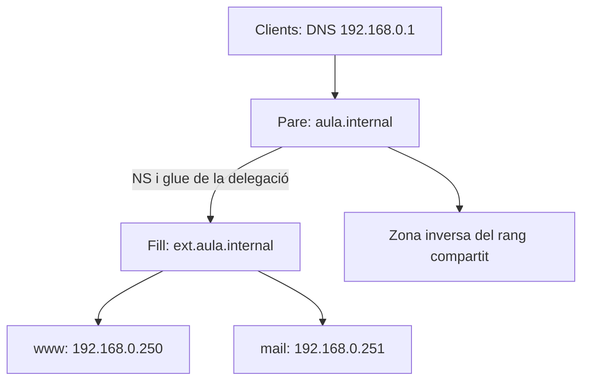

# ⚒️ Configuració de subzona al servei DNS a Ubuntu 24.04

Aquesta guia continua la [configuració del servidor DNS Linux](../README.md). Abans de començar, cal llegir [zones, delegació i glue](../fonaments/delegacio-i-glue.md). S'utilitza un únic escenari coherent amb la pràctica de subzona; les IP s'han d'adaptar al rang assignat a l'aula.

## 1. Escenari

| Equip | Adreça de l'exemple | Responsabilitat |
| --- | --- | --- |
| DNS del domini pare | `192.168.0.1` | Zona `aula.internal` i resolutor dels clients. |
| DNS de la zona filla | `192.168.0.2` | Zona primària `ext.aula.internal`. |
| Clients | Xarxa `192.168.0.0/24` | Consulten el DNS `192.168.0.1`. |
| Web de la zona filla | `192.168.0.250` | Exemple de registre `www.ext.aula.internal`. |
| Correu de la zona filla | `192.168.0.251` | Exemple de registre `mail.ext.aula.internal`. |

Els registres web i correu no instal·len els serveis corresponents. En aquesta guia es comprova DNS.



## 2. Configurar el servidor de la zona filla

En el segon servidor s'instal·len BIND i les ferramentes:

```bash
sudo apt update
sudo apt install bind9 bind9-utils dnsutils
```

En el bloc `options` existent de `/etc/bind/named.conf.options`, s'estableixen permisos per al laboratori:

```bind
recursion no;
allow-query { localhost; 192.168.0.0/24; };
allow-transfer { none; };
```

Aquest servidor serà autoritatiu de la zona filla. No necessita resoldre altres dominis per als clients. La configuració DNS del seu sistema operatiu és una qüestió separada.

En `/etc/bind/named.conf.local` s'afig:

```bind
zone "ext.aula.internal" {
    type primary;
    file "/etc/bind/db.ext.aula.internal";
    allow-update { none; };
};
```

Contingut de `/etc/bind/db.ext.aula.internal`:

```dns
$ORIGIN ext.aula.internal.
$TTL 300
@ IN SOA dns1.ext.aula.internal. admin.aula.internal. (
    2026111101 ; serial
    3600       ; refresh
    600        ; retry
    604800     ; expire
    300        ; negative cache minimum
)
     IN NS    dns1.ext.aula.internal.
dns1 IN A     192.168.0.2
www  IN A     192.168.0.250
mail IN A     192.168.0.251
@    IN MX    10 mail.ext.aula.internal.
```

S'ha d'adaptar la sèrie a una versió superior a la que ja existisca, validar i recarregar:

```bash
sudo named-checkconf
sudo named-checkzone ext.aula.internal /etc/bind/db.ext.aula.internal
sudo systemctl restart bind9
sudo systemctl status bind9 --no-pager
```

Si s'utilitza UFW, s'autoritza el DNS des de la xarxa del laboratori:

```bash
sudo ufw allow from 192.168.0.0/24 to any port 53 proto udp
sudo ufw allow from 192.168.0.0/24 to any port 53 proto tcp
sudo ufw status
```

S'han de conservar les regles d'administració remota existents. No cal desactivar i reactivar el tallafoc per a cada canvi.

## 3. Delegar des del servidor pare

La zona `aula.internal` ja ha d'estar configurada en el primer servidor. **S'afigen** aquestes línies al seu fitxer de zona directa, mantenint la resta de registres:

```dns
ext.aula.internal.      IN NS dns1.ext.aula.internal.
dns1.ext.aula.internal. IN A  192.168.0.2
```

El primer registre és la delegació. El segon és el glue que permet localitzar el servidor perquè el seu nom està dins de la subzona delegada. Cal incrementar la sèrie del SOA del pare.

**No es declara `ext.aula.internal` com a `type forward` per fer aquesta delegació.** Un reenviament condicional és un mecanisme diferent i podria ocultar que falten els NS del pare.

Perquè els clients puguen consultar el pare com a resolutor, les opcions del primer servidor han de permetre recursió només des de la xarxa autoritzada. Exemple de fragments dins del bloc `options`:

```bind
recursion yes;
allow-query { localhost; 192.168.0.0/24; };
allow-recursion { localhost; 192.168.0.0/24; };
allow-query-cache { localhost; 192.168.0.0/24; };
allow-transfer { none; };
```

La disponibilitat de resolució d'altres dominis dependrà també de l'eixida de xarxa i de la configuració general. No s'ha de traslladar aquesta recursió privada al servidor públic d'AWS sense limitar-ne l'accés.

Es valida el fitxer del pare amb el nom que tinga en la instal·lació. Si s'ha seguit la guia anterior:

```bash
sudo named-checkconf
sudo named-checkzone aula.internal /etc/bind/forward.aula.internal
sudo systemctl reload bind9
```

## 4. Administrar la zona inversa compartida

La delegació directa no delega el rang IP. En aquest exemple els dos servidors estan dins del mateix `/24`. Es manté una sola zona inversa `0.168.192.in-addr.arpa`, administrada pel servidor pare, i s'hi afigen els PTR necessaris:

```dns
2   IN PTR dns1.ext.aula.internal.
250 IN PTR www.ext.aula.internal.
251 IN PTR mail.ext.aula.internal.
```

Si ja existeixen PTR per a aquestes IP, s'han de revisar i actualitzar amb coherència. No s'han de deixar registres contradictoris heretats de l'exemple anterior. S'incrementa la sèrie de la zona inversa, es valida i es recarrega.

No s'ha de crear una segona còpia primària independent del mateix `/24` en el fill. Si es vol replicació, cal una zona secundària; si es vol delegació inversa, cal un disseny explícit del rang. En AWS, la inversa pública depén del proveïdor de la IP.

## 5. Verificar cada part

Des d'un client del laboratori:

```bash
# Autoritat del fill: s'espera resposta amb aa.
dig @192.168.0.2 ext.aula.internal SOA +norecurse
dig @192.168.0.2 www.ext.aula.internal A +norecurse

# Delegació del pare: revisar AUTHORITY i ADDITIONAL.
dig @192.168.0.1 www.ext.aula.internal A +norecurse

# Resolució completa mitjançant el DNS dels clients.
dig @192.168.0.1 www.ext.aula.internal A
dig @192.168.0.1 ext.aula.internal MX

# Transport TCP i zona inversa.
dig @192.168.0.2 www.ext.aula.internal A +tcp +norecurse
dig @192.168.0.1 -x 192.168.0.250
```

Es guarden les ordres i les respostes completes, amb una explicació de què acredita cada prova. `+trace` des de l'arrel pública no pot descobrir una zona privada del laboratori com `aula.internal`.

## 6. Traslladar el concepte a netsx.es

En la [pràctica d'AWS](../practiques/aa-q.3.3.5-servidor-web-de-subzona-a-aws.md), el pare és `netsx.es` i el fill és `nomcognom.netsx.es`. El professorat publica NS i glue al pare, i l'alumne administra el fill. Els registres anunciats a Internet han d'utilitzar les IP públiques adequades. La [guia de DNS i HTTPS](../fonaments/netsx-es-i-https.md) connecta la delegació amb Let's Encrypt.

!!! warning "Atenció"

    Si una consulta al DNS públic falla des de la xarxa de Conselleria, s'ha de repetir directament des d'una instància Ubuntu/Linux d'AWS. Les proves de la zona privada de VirtualBox es fan en la xarxa privada que hi té accés: AWS no pot consultar les IP privades del laboratori sense connectivitat específica. Cal documentar l'origen i seguir el [diagnòstic ordenat](../fonaments/diagnostic-dns.md).


**Referències:** [BIND ARM](https://bind9.readthedocs.io/en/stable/), [RFC 1034](https://www.rfc-editor.org/rfc/rfc1034) i [requisits de glue](https://www.rfc-editor.org/rfc/rfc9471.html).
