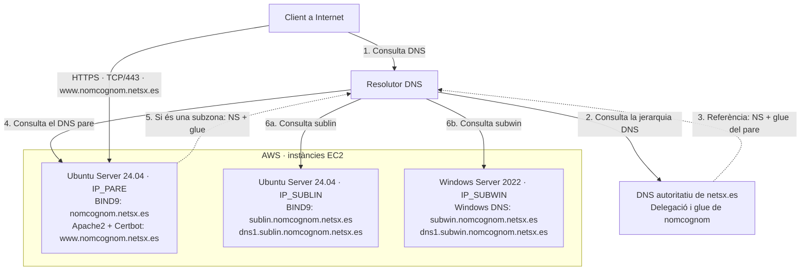

# 📎 AA-Q.3.3 - Infraestructura DNS pública, subzones i web HTTPS

## Objectiu

Documentar una infraestructura funcional a AWS formada per:

```
nomcognom.netsx.es
├── www.nomcognom.netsx.es       (Apache2 + Certbot)
├── sublin.nomcognom.netsx.es    (DNS Linux)
└── subwin.nomcognom.netsx.es    (DNS Windows)
```

Aquesta és l'**única entrega qualificable** de la secció de pràctiques DNS. Les instruccions de configuració estan en les píndoles formatives; ací no es prescriuen passos ni comandes de muntatge.

## Esquema final de la infraestructura

El diagrama mostra una possible configuració final amb **tres instàncies EC2**. El DNS pare i el web comparteixen la primera instància; cada subzona té el seu propi servidor i la seua Elastic IP.



Les fletxes numerades representen el flux simplificat de resolució, no connexions permanents entre servidors. El resolutor obté les referències de `netsx.es` i del DNS pare i després consulta directament el servidor autoritatiu corresponent. El professorat publica la delegació i el *glue* de `nomcognom.netsx.es` en `netsx.es`.

| Zona o servei | Nom | Destinació o delegació |
| --- | --- | --- |
| Zona pare | `nomcognom.netsx.es` | `dns1.nomcognom.netsx.es` → `IP_PARE` |
| Web principal | `www.nomcognom.netsx.es` | Registre A → `IP_PARE` |
| Subzona Linux | `sublin.nomcognom.netsx.es` | NS `dns1.sublin.nomcognom.netsx.es`; *glue* A → `IP_SUBLIN` |
| Subzona Windows | `subwin.nomcognom.netsx.es` | NS `dns1.subwin.nomcognom.netsx.es`; *glue* A → `IP_SUBWIN` |

Les tres Elastic IP són diferents. Els tres DNS han de permetre consultes per **UDP/53 i TCP/53**; el servidor principal també ha de permetre **TCP/80 i TCP/443** per al web i el certificat. Aplica aquestes regles tant als *Security Groups* com als tallafocs locals, si estan actius.

## Requisits funcionals

* La zona pare `nomcognom.netsx.es` és autoritativa i pública.
* `sublin.nomcognom.netsx.es` està delegada a un servidor BIND9 Linux amb NS i _glue_ correctes.
* `subwin.nomcognom.netsx.es` està delegada a un servidor Windows DNS amb NS i _glue_ correctes.
* Els tres DNS responen consultes autoritatives per UDP/53 i TCP/53, no ofereixen recursió pública i deneguen AXFR.
* `www.nomcognom.netsx.es` resol a l'Elastic IP del servidor web, mostra una web pròpia amb Apache2 i funciona per HTTPS amb un certificat vàlid de Let's Encrypt obtingut amb Certbot.
* Els _Security Groups_ i els tallafocs locals permeten només el trànsit necessari.

## Documentació a entregar

S'entrega **un únic PDF** amb:

1. Diagrama de la infraestructura: instàncies, Elastic IP, zones, NS, _glue_ i flux de resolució.
2. Taula d'IP públiques, noms DNS i funció de cada màquina.
3. Fragments de configuració rellevants de les tres zones, sense claus ni credencials.
4. Captures dels _Security Groups_ i dels tallafocs locals.
5. Evidències de:
   * SOA, NS, A i TXT de cada zona;
   * consulta directa per UDP i TCP a cada autoritatiu;
   * referència del pare cap a `sublin` i `subwin`;
   * resolució completa i `dig +trace` de les dues subzones;
   * AXFR denegat;
   * web HTTP i HTTPS amb `www.nomcognom.netsx.es`;
   * certificat: nom, emissor, vigència i `certbot renew --dry-run`.
6. Explicació curta del que demostra cada prova i de les incidències resoltes.

No s'han d'incloure contrasenyes, claus SSH, claus privades de TLS ni credencials d'AWS.

## Criteris d'avaluació

* Jerarquia DNS i delegacions correctes.
* Coherència entre NS, _glue_ i Elastic IP.
* Seguretat bàsica: recursió i transferències desactivades, ports correctes.
* Funcionament verificable de les tres zones i de HTTPS.
* Documentació clara, completa i reproduïble.

[Guies formatives de DNS](../README.md)
