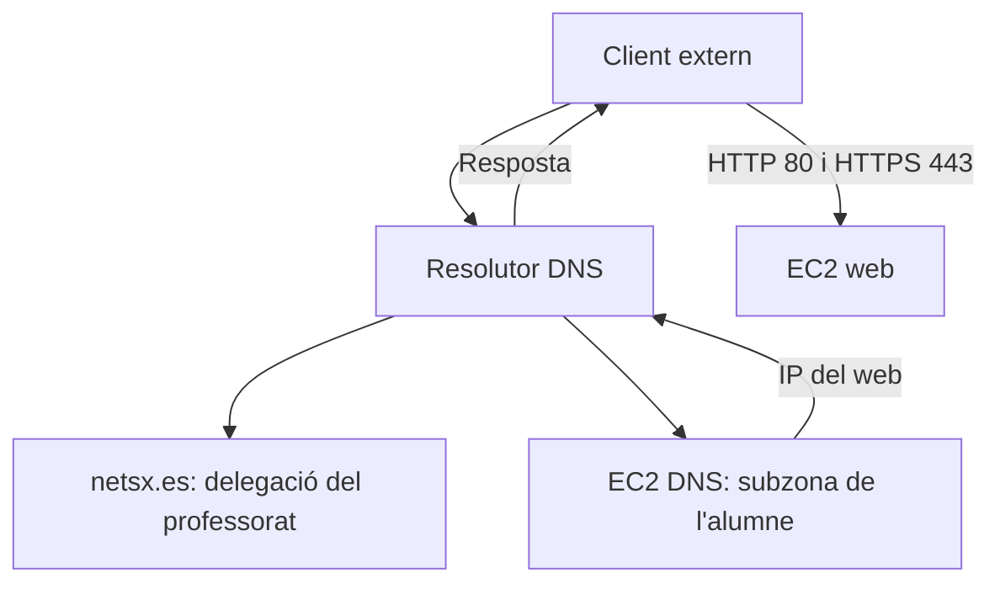

# 📎 AA-Q.3.3.6 - Servidor Web de Subzona a AWS

## 1. Objectiu de la pràctica

S'ha de desplegar una infraestructura pública amb un servidor DNS autoritatiu, una subzona delegada de `netsx.es` i un servidor web accessible per HTTPS amb un certificat de Let's Encrypt.

L'activitat integra DNS, delegació, HTTP, TLS, administració remota i diagnòstic. La teoria necessària està en [De netsx.es a HTTPS](../fonaments/netsx-es-i-https.md) i [Consultes i diagnòstic](../fonaments/diagnostic-dns.md).

## 2. Infraestructura per alumne

Es creen dues instàncies EC2, cadascuna amb l'Elastic IP prevista en el laboratori:

| Element | Servidor DNS | Servidor web |
| --- | --- | --- |
| Nom | `dns1.<nomprimercognom>.netsx.es` | `www.<nomprimercognom>.netsx.es` |
| Sistema i servei | Ubuntu/Debian amb BIND9 o Windows Server amb DNS | Ubuntu/Debian amb Apache/Nginx o Windows Server amb IIS |
| Servei públic | UDP/53 i TCP/53 | TCP/80 i TCP/443 |
| Administració | SSH o RDP des de l'origen autoritzat | SSH o RDP des de l'origen autoritzat |

El nom de la subzona s'acorda amb el professorat, utilitzant nom i primer cognom sense espais ni accents. Exemple de convenció: `arturocandela.netsx.es`. Les IP s'han d'obtindre de les instàncies pròpies; no s'han de copiar adreces de captures antigues.

El servidor DNS ha d'oferir autoritat sobre la subzona i tindre desactivada la recursió pública. La configuració de resolució del sistema operatiu de cada instància és independent de les zones publicades.

## 3. Security Groups

Es mantenen quatre grups amb funcions diferenciades. Les regles dels grups aplicats a una instància se sumen; un grup buit no anul·la permisos concedits per un altre.

| Grup | Entrada | Eixida | Aplicació |
| --- | --- | --- | --- |
| SG1 — ssh-administració | 22/TCP o 3389/TCP, segons el sistema, des de la IP pública autoritzada del centre | Segons la política del laboratori | DNS i web |
| SG2 — eixida-internet | Cap | Trànsit permés cap a Internet segons la pràctica | DNS i web |
| SG3 — dns-public | 53/UDP i 53/TCP des d'Internet | Segons la política del laboratori | Només DNS |
| SG4 — http-https-public | 80/TCP i 443/TCP des d'Internet | Segons la política del laboratori | Només web |

En l'escenari IPv4, Internet es representa amb `0.0.0.0/0`. Si es configura IPv6, cal revisar també adreces, rutes, regles IPv6 i registres AAAA. No s'ha de publicar un AAAA que no funcione.

S'ha de comprovar també el tallafoc del sistema operatiu. El port 80 ha de ser accessible per a la validació HTTP-01; el port 443 és el del servei HTTPS.

## 4. Configuració de la zona de l'alumne

La zona primària és `<nomprimercognom>.netsx.es` i ha d'incloure:

- SOA amb dades coherents i sèrie actualitzada.
- NS amb el nom del servidor DNS de l'alumne.
- A de `dns1` amb la IP pública del servidor DNS.
- A de `www` amb la IP pública del servidor web.
- A de l'àpex si també es publicarà el web sense `www`.

El registre de `dns1` ha de coincidir amb el glue que es publicarà en el pare. La IP privada d'EC2 no substitueix la IP pública en els registres destinats a Internet.



## 5. Proves abans de demanar la delegació

Primer es valida la configuració i la càrrega de la zona. Des del servidor DNS es consulta la seua IP privada o local. Des de la instància web es consulta la **IP pública del DNS**:

```text
dig @<IP_PRIVADA_DNS> <nomprimercognom>.netsx.es SOA +norecurse
dig @<IP_PUBLICA_DNS> www.<nomprimercognom>.netsx.es A +norecurse
dig @<IP_PUBLICA_DNS> www.<nomprimercognom>.netsx.es A +tcp +norecurse
```

Els marcadors entre `< >` s'han de substituir abans d'executar les ordres; s'hi mostren per descriure els paràmetres. Cal acreditar `NOERROR`, `aa` i la IP esperada. Per comprovar UDP sense canvi automàtic a TCP, es pot utilitzar `+notcp +ignore`.

En el servidor web es comprova el servei local i el VirtualHost del nom. La configuració d'Apache, Nginx o IIS ha de correspondre al FQDN que s'utilitzarà, no només a l'accés per IP.

## 6. Proves des de l'aula i des d'AWS

!!! warning "Atenció"

    Si `dig`, `nslookup`, `+trace` o altres proves públiques fallen o donen resultats inesperats des de la xarxa de Conselleria, **s'han de repetir directament en la terminal d'una instància Ubuntu/Linux d'AWS**. Es pot usar la instància web per provar el DNS. No cal esperar una confirmació del professorat ni crear obligatòriament una tercera instància per fer aquesta comparació.


S'han d'anotar origen, ordre completa, servidor consultat, hora i resultat. Si la instància web és Windows, es poden fer les consultes equivalents amb `nslookup` o utilitzar una instància Linux de proves disponible.

Una tercera instància pot aportar una comprovació independent si el laboratori ho permet. La xarxa del centre pot condicionar les consultes, però no s'ha d'atribuir automàticament qualsevol error al tallafoc. Una consulta directa correcta des d'AWS acredita l'accessibilitat del servidor des d'eixe origen; encara s'ha de verificar la delegació pública.

## 7. Delegació DNS real

Quan el DNS responga correctament des d'una altra instància, s'entreguen al professorat el nom de la subzona, el FQDN del DNS, la seua IP pública, la IP pública del web i les evidències de consulta.

El professorat afegirà en la zona **pare `netsx.es`**:

```text
<nomprimercognom>.netsx.es.      IN NS dns1.<nomprimercognom>.netsx.es.
dns1.<nomprimercognom>.netsx.es. IN A  <IP_PUBLICA_DNS>
```

La segona línia és el glue necessari perquè el servidor està dins de la zona delegada. Els registres de la zona filla continuen sent responsabilitat de l'alumne. No s'ha de configurar `type forward` com a substitut d'aquesta delegació.

Si canvia la IP pública del DNS, s'ha d'informar el professorat per actualitzar el glue, a més d'actualitzar la zona filla. No cal modificar el glue del DNS si només canvia la IP del web.

## 8. Proves després de la delegació i HTTPS

### 8.1. Resolució pública

Des d'una instància Linux d'AWS s'han de consultar SOA, NS i A sense forçar directament el servidor autoritatiu de l'alumne, i seguir la delegació:

```text
dig <nomprimercognom>.netsx.es NS
dig <nomprimercognom>.netsx.es SOA
dig www.<nomprimercognom>.netsx.es A
dig www.<nomprimercognom>.netsx.es AAAA
dig +trace www.<nomprimercognom>.netsx.es A
```

També es contrasta amb un resolutor recursiu extern accessible des d'AWS. S'ha d'identificar en les evidències quin resolutor ha contestat. La falta d'AAAA és normal si no s'ha configurat IPv6.

### 8.2. HTTP i emissió del certificat

S'ha de comprovar `http://www.<nomprimercognom>.netsx.es` des d'un altre origen. Una vegada funcione DNS i HTTP, s'obté un certificat de Let's Encrypt amb un client ACME adequat al servidor web. El [capítol de DNS i HTTPS](../fonaments/netsx-es-i-https.md) inclou un exemple amb Apache i Certbot.

La via ordinària de la pràctica és HTTP-01. S'ha d'explicar per què el port 80 ha de ser públic i per què una entrada local en `hosts` no és suficient. Si s'utilitza DNS-01 com a alternativa, s'ha de documentar la publicació del TXT i el procediment de renovació.

### 8.3. HTTPS i renovació

S'ha de comprovar `https://www.<nomprimercognom>.netsx.es` amb navegador i `curl`, sense ignorar errors de certificat. Cal revisar el nom inclòs en el certificat, l'emissor i la vigència.

Amb Certbot, s'ha de comprovar la renovació amb `sudo certbot renew --dry-run` i identificar el temporitzador o mecanisme equivalent. Si s'utilitza un altre client, s'aporta la prova equivalent.

## 9. Contingut mínim del web

- Pàgina `index.html` amb la identificació acadèmica indicada pel professorat.
- Missatge que identifique el servei i la subzona.
- Accés funcional mitjançant el nom i HTTPS.
- Opcionalment, estil CSS, imatges i pàgines addicionals.

## 10. Documentació a entregar

### 10.1. Configuració

- Noms de la subzona, DNS i web; IP públiques i funció de cadascuna.
- Captures de Security Groups i dels permisos del tallafoc local.
- En BIND: declaració de zona, opcions rellevants i fitxer de zona. En Windows: zona, SOA, NS, A i configuració pertinent.
- Dades comunicades al professorat per crear la delegació.

### 10.2. Evidències i interpretació

- Validació i consulta local del servidor DNS.
- Consultes al DNS públic des d'una altra instància, per UDP i TCP.
- NS i glue del pare i resposta autoritativa del fill.
- Resolució pública i recorregut de delegació des d'AWS.
- Proves des de l'aula i comparació amb AWS si hi ha diferències.
- HTTP, HTTPS, dades públiques del certificat i prova de renovació.
- Explicació de què demostra cada prova i de les incidències trobades.

No s'han d'incloure claus privades, claus d'accés d'AWS ni credencials en el lliurament.

## 11. Criteris d'avaluació

- Funcionament del DNS autoritatiu i coherència dels registres.
- Delegació DNS completada amb NS i glue correctes.
- Publicació del servidor web pel nom assignat.
- HTTPS amb certificat vàlid i renovació comprovada.
- Configuració correcta de Security Groups i tallafoc local.
- Distinció entre proves locals, directes i de resolució pública.
- Diagnòstic raonat i comparació aula/AWS quan calga.
- Documentació clara, completa i reproduïble.

## 12. Activitats d'aprofundiment

En acabar les tasques principals abans del temps previst, es realitzen les activitats d'aprofundiment indicades pel professorat:

- Crear una pàgina personal responsive amb Bootstrap; es pot utilitzar IA explicant l'adaptació realitzada.
- Publicar també el web sense `www` i explicar els registres, VirtualHost i noms del certificat necessaris.
- Investigar el PTR de la IP pública. Comparar la resposta d'un resolutor públic amb una zona inversa creada localment i explicar qui té l'autoritat real. Si AWS Academy no permet modificar el PTR, documentar la limitació; no s'ha de presentar una resposta local com si fora pública.
- Incorporar les evidències al lliurament de la pràctica.

**Referències:** [teoria de delegació](../fonaments/delegacio-i-glue.md), [Let's Encrypt](https://letsencrypt.org/docs/challenge-types/), [Certbot](https://eff-certbot.readthedocs.io/en/stable/using.html) i [PTR públic en AWS](https://docs.aws.amazon.com/AWSEC2/latest/UserGuide/Using_Elastic_Addressing_Reverse_DNS.html).
