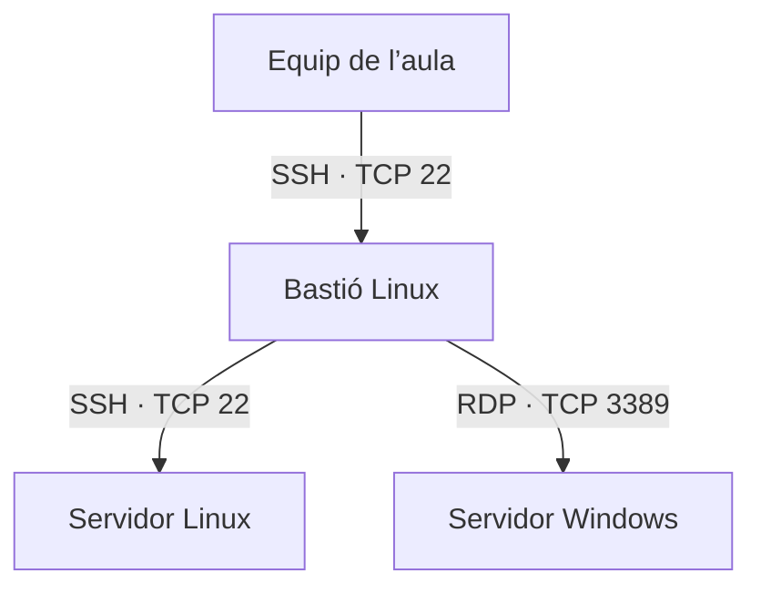

# Accés a Linux i Windows mitjançant un bastió SSH en AWS

## Repte

Des de l’equip de l’aula, cal obrir una sessió SSH en un servidor Linux i una sessió RDP en un servidor Windows. Els dos accessos han de passar per un bastió Linux. En acabar, s’ha de demostrar que els ports d’administració dels servidors només admeten connexions des del bastió.

## Punt de partida

Es necessiten tres instàncies EC2 en la mateixa VPC: el bastió amb IP pública i accés SSH amb clau, un Linux amb SSH i un Windows amb RDP habilitat. Anota les IP privades dels dos servidors i comprova que disposes de les credencials de cada màquina. Repassa [Túnels i redirecció de ports](../fonaments/tunels-i-redireccio-de-ports.md) i [Escriptori remot amb RDP i VNC](../fonaments/rdp-i-vnc.md).



## 1. Configura els grups de seguretat

Al bastió, permet TCP 22 des de la IP pública de l’aula (amb `/32` si és una sola IPv4). En els grups dels servidors de destí, crea estes dues regles d’entrada:

| Destí | Port TCP | Origen |
| --- | --- | --- |
| Linux | 22 | Grup de seguretat del bastió |
| Windows | 3389 | Grup de seguretat del bastió |

Comprova que el grup emprat com a origen està associat al bastió i que les seues regles d’eixida li permeten arribar als dos serveis. Quan funcionen els túnels, retira dels servidors les regles que permeten l’accés directe a eixos ports. Revisa tots els grups associats a cada instància, perquè AWS suma les seues regles. Si hi ha serveis web en els ports 80 i 443, gestiona’ls per separat.

## 2. Obri els dos túnels des de l’equip de l’aula

Afig este bloc a `~/.ssh/config` i substitueix els valors en majúscules. El port local 13389 deixa lliure el 3389 del teu equip, si ja està ocupat.

```sshconfig
Host bastio-sx
    HostName IP_PUBLICA_BASTIO
    User USUARI_BASTIO
    IdentityFile ~/.ssh/bastio.pem
    ExitOnForwardFailure yes
    LocalForward 127.0.0.1:2222 IP_PRIVADA_LINUX:22
    LocalForward 127.0.0.1:13389 IP_PRIVADA_WINDOWS:3389
```

Executa `ssh -N bastio-sx` i deixa la terminal oberta. El client SSH escolta en els dos ports locals. Quan un programa es connecta a un d’eixos ports, el bastió obri la connexió al servei de destí.

## 3. Comprova els accessos i documenta’ls

1. En una altra terminal, executa `ssh -i ~/.ssh/linux.pem -p 2222 USUARI_LINUX@127.0.0.1` si el servidor Linux usa autenticació amb clau. Usa la clau del Linux de destí. Executa `hostname` i `whoami` per identificar la màquina i l’usuari.
2. En el client RDP, connecta a `127.0.0.1:13389` amb les credencials del Windows. Executa `hostname` dins de la sessió per identificar la màquina.
3. Guarda una evidència de les regles d’entrada i de cada sessió. Si algun destí té IP pública, comprova des de l’aula que el seu port d’administració ja no és accessible directament. Si només té IP privada, mostra-ho junt amb les regles. Tanca el túnel i comprova que ja no pots obrir sessions noves pels ports locals.
4. Explica quins ports escolten a l’equip de l’aula, quins escolten a AWS i per què els servidors veuen el bastió com a origen. Oculta les credencials i el contingut de les claus privades en les evidències.

Si `ssh -N bastio-sx` arranca però un servei falla, revisa la IP privada, les regles d’AWS, el tallafoc del servidor i si el servei està escoltant. `ExitOnForwardFailure` detecta errors en establir les redireccions, com un port local ocupat. La connectivitat fins al servei es comprova quan s’intenta utilitzar el túnel.

## Referències

- [Regles i referències entre grups de seguretat d’AWS](https://docs.aws.amazon.com/vpc/latest/userguide/security-group-rules.html)
- [Manual de configuració del client OpenSSH](https://man.openbsd.org/ssh_config)
